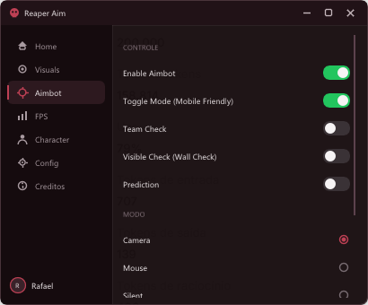

# rbx_esp — Reaper Aim

Overlay externo para Roblox com menu **Reaper Aim**, escrito em C++20 (Win32 + DirectX 11 + Dear ImGui).

O processo do jogo é aberto somente com `PROCESS_VM_READ | PROCESS_QUERY_INFORMATION`.
Não há injeção de DLL, `WriteProcessMemory` nem driver de kernel.



## Status

- Menu completo: Home, Visuals, Aimbot, FPS, Character, Config e Creditos.
- ESP com caixas, nomes, distância, vida, time, skeleton e Box Fill.
- **ESP desativado nesta instalação.** O cliente GDK instalado
  (`C:\XboxGames\Roblox\Content\RobloxPlayerBeta.exe`) não possui a pasta
  `version-*` e não corresponde ao perfil `version-11f155f3450f4c8e` declarado
  em `src/offsets.h`. O app abre e mostra o menu, mas não lê memória de um
  build sem offsets verificados.
- Aimbot, FPS e demais controles são apenas interface: nenhuma escrita no jogo.

## Compilar

Requisitos: Windows 10/11, Visual Studio 2022 (Desktop C++) e CMake 3.21+.

```powershell
cmake -S . -B build -G "Visual Studio 17 2022" -A x64
cmake --build build --config Release
```

Saída:

- `build/bin/rbx_esp.exe`
- `build/bin/1.exe` (cópia idêntica gerada no pós-build)

## Uso

| Tecla | Ação |
|-------|------|
| `F1`  | Mostra / oculta o menu |
| `F2`  | Encerra o app |

- O menu é arrastável pela barra de título.
- Fora do menu, o overlay é click-through: os cliques vão para a janela de baixo.
- O menu lembra a posição durante a execução e fecha pelo `X` sem encerrar o app.

## Estrutura

```
src/            código do app (main, overlay, panel, esp, game, memory, log)
vendor/imgui/   Dear ImGui v1.91.8 (MIT)
tools/          scripts de teste da interface
docs/           imagem de prévia
CMakeLists.txt  build MSVC x64
```

## Aviso

Projeto educacional, sem afiliação com a Roblox Corporation. O uso pode violar
os Termos de Serviço do jogo. Use por sua conta e risco.
